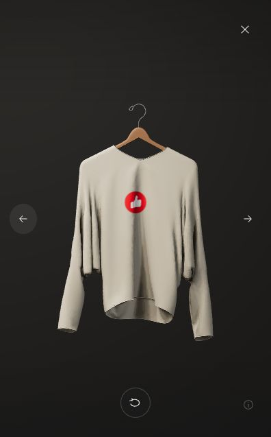

# 有赞 · 品牌影棚

一个 React + Three.js 的互动服装衣架 Demo。支持选款、拿取、正反面查看与回挂，包含逐款布料响应、小尺寸有赞印花和影棚光照。

## 本地运行

建议 Node.js 22.12 或更新版本。

```bash
npm ci
npm run dev
```

打开终端显示的本地地址，默认是 http://127.0.0.1:5173/。

```bash
npm test
npm run build
npm run preview
```

- 鼠标悬停展开，点击查看单品；触屏可左右切换。
- 左右方向键选款，Enter 查看，Esc 返回。
- 查看单品时用翻转按钮切换正反面。

## 结构

- `src/scene.js`：场景、交互状态、固定步长模拟和绘制。
- `src/surface-*.js`：布面约束、碰撞、形变场与材质绑定。
- `src/catalog.js`：款式、颜色、印花和独立运动参数。
- `src/studio-*.js`：影棚光照与阴影。
- `public/models/`：实际模型、模拟网格和阴影细节资源。
- `public/textures/`、`public/brand/`：扫描面料及品牌素材。
- `tests/`：几何、接缝、衣架、布料约束、材质和绘制回归。

## 当前性能优化

运动期间，背景服装使用从真实渲染布面生成的简化阴影索引。可见衣服、选中款、贴图、logo 和布料求解保持完整；停稳后恢复完整阴影并停止重复渲染。模型/索引哈希不匹配时自动退回完整阴影。

替换模型后可以重新生成阴影资源：

```bash
npm run build:shadows
npm test
```

当前 248 项测试通过。帧率仍需继续优化，尤其是布料碰撞求解长帧；没有稳定 60fps 或真机性能保证。材质与运动参数是展示预设，并非实测面料标定。

## 素材

保留应用内的模型署名和 `public/textures/*/SOURCE.txt` 中的扫描材质来源。长袖模型署名：CG Elves / Camille Kleinman。离线简化工具 meshoptimizer 的 MIT 声明位于 `scripts/vendor/LICENSE.md`。第三方模型、纹理与品牌素材沿用各自授权，本仓库未为全部素材声明统一开源许可证。


